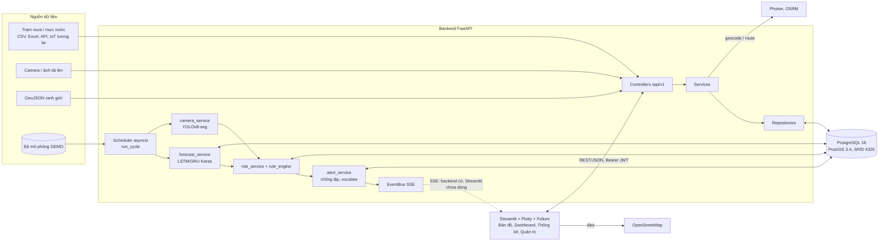

# Kiến trúc hệ thống

Modular monolith, Client–Server. Một tiến trình FastAPI phục vụ REST API, SSE và chạy pipeline định kỳ; giao diện Streamlit (cổng 5173 khi chạy `npm run dev`, 8501 trong Docker) là một tiến trình riêng gọi REST API (cổng 8000), gửi `X-Forwarded-For` để rate limit theo IP người dùng. Giao diện không truy cập CSDL trực tiếp.

## Luồng xử lý chính (mỗi `SCHEDULER_INTERVAL_SECONDS`, mặc định 300 s)

1. **Thu thập**: DEMO sinh bản ghi mô phỏng tới giờ hiện tại; LIVE nhận qua import/API. Mỗi giá trị được gắn
   `quality_flag` (VALID/SUSPECT/MISSING) — kiểm tra âm, vượt ngưỡng vật lý, bước nhảy bất thường; trùng bị bỏ qua.
2. **Camera**: khung hình mới (ảnh cán bộ tải lên; quét camera giao thông tự động nếu bật `CAMERA_SCAN_ENABLED`, hiện tắt) → YOLOv8-seg → tỉ lệ ngập trong ROI → `camera_detections`.
3. **Dự báo**: mỗi trạm lấy 24h gần nhất → LSTM/GRU → 6 mốc (mưa, mực nước, xác suất ngập) → `forecasts`
   (cold-start mượn dữ liệu trạm lân cận cùng cụm; có thể dùng mô hình tinh chỉnh `GRU_CLUSTER` khi nền khớp mô hình active).
4. **Đánh giá rủi ro**: mỗi khu vực × mốc 0–6h tổng hợp xác suất, mưa, mực nước/ngưỡng, camera, lịch sử, độ tươi
   dữ liệu → rule engine → `flood_risk_snapshots` (kèm giải thích).
5. **Cảnh báo**: mức xấu nhất ≥ MEDIUM → tạo/escalate (1 cảnh báo mở mỗi khu vực, cooldown) → thông báo cán bộ
   → SSE (backend) / Streamlit hỏi lại mỗi 60 s để cập nhật bản đồ/danh sách.

## MVC trong backend

| Lớp | Thư mục | Vai trò |
|---|---|---|
| Model | `app/models/entities.py` | 24 bảng SQLAlchemy, quan hệ, ràng buộc, cột spatial |
| View | `app/schemas/views.py` | Hợp đồng request/response Pydantic (validation tại biên) |
| Controller | `app/controllers/` | Router FastAPI mỏng: phân quyền, gọi service, audit |
| Service | `app/services/` | Nghiệp vụ: rule engine (pure), cảnh báo, thống kê, Excel, GIS, định tuyến, camera, người dùng |
| Repository | `app/repositories/` | Truy vấn dùng chung (phân trang, giá trị mới nhất, chuỗi quan trắc) |
| Core | `app/core/` | Cấu hình `.env` (`POSTGRES_*`), DB session, Geometry type (PostGIS lon/lat), bcrypt/JWT, RBAC deps, lỗi chuẩn |
| AI | `app/ai/` | Tiền xử lý, mô hình, huấn luyện, suy luận, đánh giá |
| Jobs | `app/jobs/` | Pipeline, mô phỏng DEMO, backfill |

## Bảo mật

- Mật khẩu bcrypt (cost 12); JWT HS256 với `JWT_SECRET` ≥ 32 ký tự (ứng dụng từ chối khởi động nếu thiếu).
- RBAC ở backend cho mọi endpoint ghi/nhạy cảm; người dân chỉ thấy cảnh báo công khai đang hoạt động, không thấy
  `stream_url`, người phụ trách, giải thích nội bộ, ảnh camera không công khai, sự kiện SSE nội bộ.
- Rate limit đăng nhập/đăng ký; so sánh mật khẩu với hash giả khi user không tồn tại (chống dò tài khoản).
- Upload: kiểm tra phần mở rộng, kích thước, giải mã thật bằng OpenCV; lưu tên ngẫu nhiên; ảnh phục vụ qua API có
  kiểm quyền và chặn path traversal; chính sách lưu trữ `retention_days`.
- SQL qua ORM/tham số hoá; tìm kiếm văn bản qua `unaccent(col) ILIKE unaccent(...)` với ký tự đại diện đã escape; Excel chống formula injection; header bảo mật
  (nosniff, X-Frame-Options DENY); CORS giới hạn theo `CORS_ORIGINS`; chặn open redirect sau đăng nhập.
- Audit log cho đăng nhập, CRUD, xử lý cảnh báo, đổi quy tắc/mô hình/cấu hình, xuất/nhập dữ liệu.

## Giao diện Streamlit

`streamlit_app/`: `app.py` (điều hướng theo vai trò từ `nav.py`), `api.py` (client httpx, token trong `st.session_state`, cache có TTL), `views/` (map, alerts, forecasts, history, dashboard, statistics, stations, cameras, models, users, settings, account, notifications). Folium vẽ bản đồ (phường tô theo mức rủi ro, quận chỉ viền), Plotly vẽ biểu đồ. Kiểm thử bằng `streamlit.testing` (AppTest) trong `streamlit_app/tests`.
