# Thiết kế cơ sở dữ liệu — `urban_flood_dss` (PostgreSQL 16 + PostGIS 3.4)

> Tài liệu sinh tự động từ SQLAlchemy metadata (`backend/app/models/entities.py`), khớp migration `0001_initial_postgis_baseline` (extension `postgis`, `citext`, `unaccent`).

## Nguyên tắc

- Thời gian lưu **UTC** (`TIMESTAMP`), hiển thị theo Asia/Ho_Chi_Minh ở giao diện/Excel.
- Dữ liệu không gian: `geometry(POINT|MULTIPOLYGON, 4326)` của PostGIS, chỉ mục GiST; thứ tự trục tự nhiên lon/lat (không còn `axis-order`). Khoảng cách dùng `ST_DistanceSphere`.
- Chống trùng: `UNIQUE(station_id, observed_at)` cho quan trắc, `INSERT ... ON CONFLICT DO NOTHING` khi nhập; `UNIQUE` cho mã trạm/camera/user.
- `users.username` và `users.email` là `CITEXT` (không phân biệt hoa thường, không còn giới hạn độ dài ở DB; schema Pydantic vẫn kiểm độ dài). Tìm kiếm văn bản dùng `unaccent(col) ILIKE unaccent(...)` nên không phân biệt hoa thường và dấu. Các cột `code` của trạm/khu vực/camera phân biệt hoa thường (mã sinh ra luôn viết hoa). Thứ tự sắp xếp chữ theo collation của cơ sở dữ liệu PostgreSQL.
- Xoá mềm (`deleted_at`) cho trạm, camera, người dùng; lịch sử đo giữ nguyên.
- Cờ `is_simulated` + `data_sources.is_simulated` phân biệt dữ liệu DEMO/MÔ PHỎNG với dữ liệu thật.
- `alert_rules` bất biến theo phiên bản (mỗi lần sửa = version mới) → lịch sử thay đổi quy tắc.

## ERD

```mermaid
erDiagram
  data_sources {
    INTEGER id PK
    VARCHAR code
    VARCHAR name
    VARCHAR kind
    BOOLEAN is_simulated
    VARCHAR license
    VARCHAR url
    TEXT description
  }
  model_versions {
    INTEGER id PK
    VARCHAR name
    VARCHAR model_type
    VARCHAR version
    VARCHAR artifact_path
    TEXT dataset_description
    BOOLEAN trained_on_simulated
    JSON metrics
    JSON params
    VARCHAR status
    BOOLEAN is_active
    TIMESTAMP trained_at
    FLOAT training_seconds
    TIMESTAMP created_at
  }
  roles {
    INTEGER id PK
    VARCHAR code
    VARCHAR name
  }
  users {
    INTEGER id PK
    VARCHAR username
    VARCHAR email
    VARCHAR full_name
    VARCHAR password_hash
    BOOLEAN is_active
    INTEGER token_version
    TIMESTAMP last_login_at
    TIMESTAMP deleted_at
    TIMESTAMP created_at
    TIMESTAMP updated_at
  }
  administrative_areas {
    INTEGER id PK
    VARCHAR code
    VARCHAR name
    VARCHAR level
    INTEGER parent_id FK
    MULTIPOLYGON_SRID_4326 geom
    FLOAT centroid_lat
    FLOAT centroid_lon
    FLOAT susceptibility
    VARCHAR cluster
    INTEGER source_id FK
    TIMESTAMP created_at
    TIMESTAMP updated_at
  }
  alert_rules {
    INTEGER id PK
    INTEGER version
    VARCHAR name
    JSON config
    BOOLEAN is_active
    TEXT notes
    INTEGER created_by FK
    TIMESTAMP created_at
  }
  audit_logs {
    BIGINT id PK
    INTEGER user_id FK
    VARCHAR username
    VARCHAR action
    VARCHAR entity_type
    VARCHAR entity_id
    JSON detail
    VARCHAR ip
    TIMESTAMP created_at
  }
  export_history {
    INTEGER id PK
    INTEGER user_id FK
    VARCHAR report_type
    VARCHAR file_format
    JSON filters
    VARCHAR file_name
    INTEGER row_count
    TIMESTAMP created_at
  }
  system_settings {
    VARCHAR key PK
    JSON value
    VARCHAR description
    INTEGER updated_by FK
    TIMESTAMP updated_at
  }
  training_runs {
    INTEGER id PK
    INTEGER model_version_id FK
    VARCHAR task
    TIMESTAMP started_at
    TIMESTAMP finished_at
    VARCHAR status
    JSON params
    JSON metrics
    TEXT log
  }
  user_roles {
    INTEGER user_id PK
    INTEGER role_id PK
  }
  alerts {
    INTEGER id PK
    VARCHAR code
    INTEGER area_id FK
    VARCHAR risk_level
    VARCHAR status
    VARCHAR title
    TEXT message
    JSON recommendations
    JSON explanation
    FLOAT score
    INTEGER horizon_h
    INTEGER rule_id FK
    BOOLEAN is_simulated
    BOOLEAN is_public
    INTEGER assigned_to FK
    VARCHAR verified_outcome
    TIMESTAMP triggered_at
    TIMESTAMP acknowledged_at
    TIMESTAMP resolved_at
    TIMESTAMP closed_at
    TIMESTAMP updated_at
  }
  cameras {
    INTEGER id PK
    VARCHAR code
    VARCHAR name
    INTEGER area_id FK
    FLOAT latitude
    FLOAT longitude
    POINT_SRID_4326 location
    VARCHAR stream_url
    VARCHAR status
    JSON roi
    BOOLEAN is_public
    INTEGER retention_days
    INTEGER source_id FK
    TIMESTAMP deleted_at
    TIMESTAMP created_at
    TIMESTAMP updated_at
  }
  flood_risk_snapshots {
    BIGINT id PK
    INTEGER area_id FK
    TIMESTAMP issued_at
    INTEGER horizon_h
    VARCHAR risk_level
    FLOAT score
    FLOAT flood_probability
    FLOAT rainfall_mm
    FLOAT water_level_ratio
    FLOAT camera_flood_ratio
    JSON explanation
    INTEGER rule_id FK
    BOOLEAN is_simulated
  }
  historical_flood_events {
    INTEGER id PK
    INTEGER area_id FK
    VARCHAR location_name
    FLOAT latitude
    FLOAT longitude
    POINT_SRID_4326 location
    TIMESTAMP started_at
    TIMESTAMP ended_at
    FLOAT max_depth_cm
    VARCHAR cause
    TEXT description
    BOOLEAN is_simulated
    INTEGER source_id FK
  }
  monitoring_stations {
    INTEGER id PK
    VARCHAR code
    VARCHAR name
    VARCHAR station_type
    VARCHAR address
    INTEGER area_id FK
    FLOAT latitude
    FLOAT longitude
    POINT_SRID_4326 location
    VARCHAR managing_unit
    VARCHAR status
    INTEGER interval_minutes
    FLOAT flood_threshold_cm
    TIMESTAMP last_observation_at
    INTEGER source_id FK
    TEXT notes
    TIMESTAMP deleted_at
    TIMESTAMP created_at
    TIMESTAMP updated_at
  }
  alert_history {
    INTEGER id PK
    INTEGER alert_id FK
    VARCHAR action
    VARCHAR from_status
    VARCHAR to_status
    TEXT note
    INTEGER changed_by FK
    TIMESTAMP changed_at
  }
  camera_frames {
    BIGINT id PK
    INTEGER camera_id FK
    TIMESTAMP captured_at
    VARCHAR image_path
    INTEGER uploaded_by FK
    BOOLEAN is_simulated
  }
  forecasts {
    BIGINT id PK
    INTEGER station_id FK
    INTEGER area_id FK
    INTEGER model_version_id FK
    TIMESTAMP issued_at
    INTEGER horizon_h
    TIMESTAMP target_time
    FLOAT rainfall_mm
    FLOAT water_level_cm
    FLOAT flood_probability
    VARCHAR data_quality
    BOOLEAN is_cold_start
    BOOLEAN is_simulated
  }
  notifications {
    BIGINT id PK
    INTEGER user_id FK
    INTEGER alert_id FK
    VARCHAR title
    TEXT body
    VARCHAR level
    BOOLEAN is_read
    TIMESTAMP created_at
  }
  rainfall_observations {
    INTEGER station_id FK
    FLOAT rainfall_mm
    INTEGER source_id FK
    BIGINT id PK
    TIMESTAMP observed_at
    VARCHAR quality_flag
    BOOLEAN is_simulated
    TIMESTAMP ingested_at
  }
  sensors {
    INTEGER id PK
    INTEGER station_id FK
    VARCHAR sensor_type
    VARCHAR unit
    VARCHAR model
    BOOLEAN is_active
    TIMESTAMP installed_at
  }
  water_level_observations {
    INTEGER station_id FK
    FLOAT water_level_cm
    INTEGER source_id FK
    BIGINT id PK
    TIMESTAMP observed_at
    VARCHAR quality_flag
    BOOLEAN is_simulated
    TIMESTAMP ingested_at
  }
  camera_detections {
    BIGINT id PK
    BIGINT frame_id FK
    INTEGER camera_id FK
    INTEGER model_version_id FK
    TIMESTAMP detected_at
    VARCHAR method
    FLOAT flood_ratio
    FLOAT confidence
    INTEGER num_regions
    VARCHAR result_image_path
    JSON details
    BOOLEAN is_simulated
  }
  administrative_areas ||--o{ administrative_areas : "parent_id"
  administrative_areas ||--o{ alerts : "area_id"
  administrative_areas ||--o{ cameras : "area_id"
  administrative_areas ||--o{ flood_risk_snapshots : "area_id"
  administrative_areas ||--o{ forecasts : "area_id"
  administrative_areas ||--o{ historical_flood_events : "area_id"
  administrative_areas ||--o{ monitoring_stations : "area_id"
  alert_rules ||--o{ alerts : "rule_id"
  alert_rules ||--o{ flood_risk_snapshots : "rule_id"
  alerts ||--o{ alert_history : "alert_id"
  alerts ||--o{ notifications : "alert_id"
  camera_frames ||--o{ camera_detections : "frame_id"
  cameras ||--o{ camera_detections : "camera_id"
  cameras ||--o{ camera_frames : "camera_id"
  data_sources ||--o{ administrative_areas : "source_id"
  data_sources ||--o{ cameras : "source_id"
  data_sources ||--o{ historical_flood_events : "source_id"
  data_sources ||--o{ monitoring_stations : "source_id"
  data_sources ||--o{ rainfall_observations : "source_id"
  data_sources ||--o{ water_level_observations : "source_id"
  model_versions ||--o{ camera_detections : "model_version_id"
  model_versions ||--o{ forecasts : "model_version_id"
  model_versions ||--o{ training_runs : "model_version_id"
  monitoring_stations ||--o{ forecasts : "station_id"
  monitoring_stations ||--o{ rainfall_observations : "station_id"
  monitoring_stations ||--o{ sensors : "station_id"
  monitoring_stations ||--o{ water_level_observations : "station_id"
  roles ||--o{ user_roles : "role_id"
  users ||--o{ alert_history : "changed_by"
  users ||--o{ alert_rules : "created_by"
  users ||--o{ alerts : "assigned_to"
  users ||--o{ audit_logs : "user_id"
  users ||--o{ camera_frames : "uploaded_by"
  users ||--o{ export_history : "user_id"
  users ||--o{ notifications : "user_id"
  users ||--o{ system_settings : "updated_by"
  users ||--o{ user_roles : "user_id"
```

## Từ điển dữ liệu

### `data_sources`

| Cột | Kiểu | Null | Khoá/Ràng buộc |
|---|---|---|---|
| id | INTEGER | không | PK |
| code | VARCHAR(50) | không | UNIQUE |
| name | VARCHAR(200) | không |  |
| kind | VARCHAR(20) | không |  |
| is_simulated | BOOLEAN | không |  |
| license | VARCHAR(200) | không |  |
| url | VARCHAR(500) | không |  |
| description | TEXT | không |  |

### `model_versions`

| Cột | Kiểu | Null | Khoá/Ràng buộc |
|---|---|---|---|
| id | INTEGER | không | PK |
| name | VARCHAR(80) | không |  |
| model_type | VARCHAR(30) | không |  |
| version | VARCHAR(40) | không |  |
| artifact_path | VARCHAR(300) | không |  |
| dataset_description | TEXT | không |  |
| trained_on_simulated | BOOLEAN | không |  |
| metrics | JSON | có |  |
| params | JSON | có |  |
| status | VARCHAR(20) | không |  |
| is_active | BOOLEAN | không |  |
| trained_at | TIMESTAMP | có |  |
| training_seconds | FLOAT | có |  |
| created_at | TIMESTAMP | không |  |

Ràng buộc/chỉ mục: UNIQUE(name, version)

### `roles`

| Cột | Kiểu | Null | Khoá/Ràng buộc |
|---|---|---|---|
| id | INTEGER | không | PK |
| code | VARCHAR(20) | không | UNIQUE |
| name | VARCHAR(100) | không |  |

### `users`

| Cột | Kiểu | Null | Khoá/Ràng buộc |
|---|---|---|---|
| id | INTEGER | không | PK |
| username | CITEXT | không | UNIQUE |
| email | CITEXT | không | UNIQUE |
| full_name | VARCHAR(120) | không |  |
| password_hash | VARCHAR(255) | không |  |
| is_active | BOOLEAN | không |  |
| token_version | INTEGER | không |  |
| last_login_at | TIMESTAMP | có |  |
| deleted_at | TIMESTAMP | có |  |
| created_at | TIMESTAMP | không |  |
| updated_at | TIMESTAMP | không |  |

### `administrative_areas`

| Cột | Kiểu | Null | Khoá/Ràng buộc |
|---|---|---|---|
| id | INTEGER | không | PK |
| code | VARCHAR(30) | không | UNIQUE |
| name | VARCHAR(120) | không |  |
| level | VARCHAR(20) | không |  |
| parent_id | INTEGER | có | FK → administrative_areas.id |
| geom | MULTIPOLYGON SRID 4326 | không |  |
| centroid_lat | FLOAT | không |  |
| centroid_lon | FLOAT | không |  |
| susceptibility | FLOAT | không |  |
| cluster | VARCHAR(30) | không |  |
| source_id | INTEGER | không | FK → data_sources.id |
| created_at | TIMESTAMP | không |  |
| updated_at | TIMESTAMP | không |  |

Ràng buộc/chỉ mục: INDEX ix_administrative_areas_name(name); INDEX sx_area_geom(geom) USING gist

### `alert_rules`

| Cột | Kiểu | Null | Khoá/Ràng buộc |
|---|---|---|---|
| id | INTEGER | không | PK |
| version | INTEGER | không | UNIQUE |
| name | VARCHAR(120) | không |  |
| config | JSON | không |  |
| is_active | BOOLEAN | không |  |
| notes | TEXT | không |  |
| created_by | INTEGER | có | FK → users.id |
| created_at | TIMESTAMP | không |  |

### `audit_logs`

| Cột | Kiểu | Null | Khoá/Ràng buộc |
|---|---|---|---|
| id | BIGINT | không | PK |
| user_id | INTEGER | có | FK → users.id |
| username | VARCHAR(50) | không |  |
| action | VARCHAR(50) | không |  |
| entity_type | VARCHAR(50) | không |  |
| entity_id | VARCHAR(50) | không |  |
| detail | JSON | có |  |
| ip | VARCHAR(45) | không |  |
| created_at | TIMESTAMP | không |  |

Ràng buộc/chỉ mục: INDEX ix_audit_entity(entity_type, entity_id); INDEX ix_audit_time(created_at)

### `export_history`

| Cột | Kiểu | Null | Khoá/Ràng buộc |
|---|---|---|---|
| id | INTEGER | không | PK |
| user_id | INTEGER | có | FK → users.id |
| report_type | VARCHAR(40) | không |  |
| file_format | VARCHAR(10) | không |  |
| filters | JSON | có |  |
| file_name | VARCHAR(200) | không |  |
| row_count | INTEGER | không |  |
| created_at | TIMESTAMP | không |  |

### `system_settings`

| Cột | Kiểu | Null | Khoá/Ràng buộc |
|---|---|---|---|
| key | VARCHAR(80) | không | PK |
| value | JSON | có |  |
| description | VARCHAR(255) | không |  |
| updated_by | INTEGER | có | FK → users.id |
| updated_at | TIMESTAMP | không |  |

### `training_runs`

| Cột | Kiểu | Null | Khoá/Ràng buộc |
|---|---|---|---|
| id | INTEGER | không | PK |
| model_version_id | INTEGER | có | FK → model_versions.id |
| task | VARCHAR(30) | không |  |
| started_at | TIMESTAMP | không |  |
| finished_at | TIMESTAMP | có |  |
| status | VARCHAR(20) | không |  |
| params | JSON | có |  |
| metrics | JSON | có |  |
| log | TEXT | không |  |

### `user_roles`

| Cột | Kiểu | Null | Khoá/Ràng buộc |
|---|---|---|---|
| user_id | INTEGER | không | PK, FK → users.id |
| role_id | INTEGER | không | PK, FK → roles.id |

### `alerts`

| Cột | Kiểu | Null | Khoá/Ràng buộc |
|---|---|---|---|
| id | INTEGER | không | PK |
| code | VARCHAR(30) | không | UNIQUE |
| area_id | INTEGER | không | FK → administrative_areas.id |
| risk_level | VARCHAR(10) | không |  |
| status | VARCHAR(15) | không |  |
| title | VARCHAR(200) | không |  |
| message | TEXT | không |  |
| recommendations | JSON | có |  |
| explanation | JSON | có |  |
| score | FLOAT | không |  |
| horizon_h | INTEGER | không |  |
| rule_id | INTEGER | có | FK → alert_rules.id |
| is_simulated | BOOLEAN | không |  |
| is_public | BOOLEAN | không |  |
| assigned_to | INTEGER | có | FK → users.id |
| verified_outcome | VARCHAR(15) | không |  |
| triggered_at | TIMESTAMP | không |  |
| acknowledged_at | TIMESTAMP | có |  |
| resolved_at | TIMESTAMP | có |  |
| closed_at | TIMESTAMP | có |  |
| updated_at | TIMESTAMP | không |  |

Ràng buộc/chỉ mục: INDEX ix_alert_status_area(status, area_id); INDEX ix_alert_triggered(triggered_at)

### `cameras`

| Cột | Kiểu | Null | Khoá/Ràng buộc |
|---|---|---|---|
| id | INTEGER | không | PK |
| code | VARCHAR(30) | không | UNIQUE |
| name | VARCHAR(150) | không |  |
| area_id | INTEGER | có | FK → administrative_areas.id |
| latitude | FLOAT | không |  |
| longitude | FLOAT | không |  |
| location | POINT SRID 4326 | không |  |
| stream_url | VARCHAR(500) | không |  |
| status | VARCHAR(20) | không |  |
| roi | JSON | có |  |
| is_public | BOOLEAN | không |  |
| retention_days | INTEGER | không |  |
| source_id | INTEGER | không | FK → data_sources.id |
| deleted_at | TIMESTAMP | có |  |
| created_at | TIMESTAMP | không |  |
| updated_at | TIMESTAMP | không |  |

Ràng buộc/chỉ mục: INDEX ix_cameras_name(name); INDEX ix_cameras_deleted_at(deleted_at); INDEX sx_camera_loc(location) USING gist

### `flood_risk_snapshots`

| Cột | Kiểu | Null | Khoá/Ràng buộc |
|---|---|---|---|
| id | BIGINT | không | PK |
| area_id | INTEGER | không | FK → administrative_areas.id |
| issued_at | TIMESTAMP | không |  |
| horizon_h | INTEGER | không |  |
| risk_level | VARCHAR(20) | không |  |
| score | FLOAT | không |  |
| flood_probability | FLOAT | có |  |
| rainfall_mm | FLOAT | có |  |
| water_level_ratio | FLOAT | có |  |
| camera_flood_ratio | FLOAT | có |  |
| explanation | JSON | có |  |
| rule_id | INTEGER | có | FK → alert_rules.id |
| is_simulated | BOOLEAN | không |  |

Ràng buộc/chỉ mục: UNIQUE(area_id, issued_at, horizon_h); INDEX ix_risk_issued(issued_at)

### `historical_flood_events`

| Cột | Kiểu | Null | Khoá/Ràng buộc |
|---|---|---|---|
| id | INTEGER | không | PK |
| area_id | INTEGER | có | FK → administrative_areas.id |
| location_name | VARCHAR(200) | không |  |
| latitude | FLOAT | không |  |
| longitude | FLOAT | không |  |
| location | POINT SRID 4326 | không |  |
| started_at | TIMESTAMP | không |  |
| ended_at | TIMESTAMP | có |  |
| max_depth_cm | FLOAT | có |  |
| cause | VARCHAR(50) | không |  |
| description | TEXT | không |  |
| is_simulated | BOOLEAN | không |  |
| source_id | INTEGER | không | FK → data_sources.id |

Ràng buộc/chỉ mục: INDEX sx_flood_loc(location) USING gist; INDEX ix_historical_flood_events_started_at(started_at); INDEX ix_historical_flood_events_location_name(location_name); INDEX ix_historical_flood_events_area_id(area_id)

### `monitoring_stations`

| Cột | Kiểu | Null | Khoá/Ràng buộc |
|---|---|---|---|
| id | INTEGER | không | PK |
| code | VARCHAR(30) | không | UNIQUE |
| name | VARCHAR(150) | không |  |
| station_type | VARCHAR(20) | không |  |
| address | VARCHAR(255) | không |  |
| area_id | INTEGER | có | FK → administrative_areas.id |
| latitude | FLOAT | không |  |
| longitude | FLOAT | không |  |
| location | POINT SRID 4326 | không |  |
| managing_unit | VARCHAR(150) | không |  |
| status | VARCHAR(20) | không |  |
| interval_minutes | INTEGER | không |  |
| flood_threshold_cm | FLOAT | không |  |
| last_observation_at | TIMESTAMP | có |  |
| source_id | INTEGER | không | FK → data_sources.id |
| notes | TEXT | không |  |
| deleted_at | TIMESTAMP | có |  |
| created_at | TIMESTAMP | không |  |
| updated_at | TIMESTAMP | không |  |

Ràng buộc/chỉ mục: INDEX ix_monitoring_stations_area_id(area_id); INDEX sx_station_loc(location) USING gist; INDEX ix_monitoring_stations_name(name); INDEX ix_monitoring_stations_deleted_at(deleted_at); CHECK ck_station_lon; CHECK ck_station_lat

### `alert_history`

| Cột | Kiểu | Null | Khoá/Ràng buộc |
|---|---|---|---|
| id | INTEGER | không | PK |
| alert_id | INTEGER | không | FK → alerts.id |
| action | VARCHAR(30) | không |  |
| from_status | VARCHAR(15) | có |  |
| to_status | VARCHAR(15) | có |  |
| note | TEXT | không |  |
| changed_by | INTEGER | có | FK → users.id |
| changed_at | TIMESTAMP | không |  |

Ràng buộc/chỉ mục: INDEX ix_alert_history_alert_id(alert_id)

### `camera_frames`

| Cột | Kiểu | Null | Khoá/Ràng buộc |
|---|---|---|---|
| id | BIGINT | không | PK |
| camera_id | INTEGER | có | FK → cameras.id |
| captured_at | TIMESTAMP | không |  |
| image_path | VARCHAR(300) | không |  |
| uploaded_by | INTEGER | có | FK → users.id |
| is_simulated | BOOLEAN | không |  |

Ràng buộc/chỉ mục: INDEX ix_camera_frames_camera_id(camera_id)

### `forecasts`

| Cột | Kiểu | Null | Khoá/Ràng buộc |
|---|---|---|---|
| id | BIGINT | không | PK |
| station_id | INTEGER | không | FK → monitoring_stations.id |
| area_id | INTEGER | có | FK → administrative_areas.id |
| model_version_id | INTEGER | có | FK → model_versions.id |
| issued_at | TIMESTAMP | không |  |
| horizon_h | INTEGER | không |  |
| target_time | TIMESTAMP | không |  |
| rainfall_mm | FLOAT | không |  |
| water_level_cm | FLOAT | có |  |
| flood_probability | FLOAT | không |  |
| data_quality | VARCHAR(15) | không |  |
| is_cold_start | BOOLEAN | không |  |
| is_simulated | BOOLEAN | không |  |

Ràng buộc/chỉ mục: UNIQUE(station_id, issued_at, horizon_h); INDEX ix_fc_issued(issued_at); INDEX ix_forecasts_area_id(area_id); CHECK ck_fc_prob

### `notifications`

| Cột | Kiểu | Null | Khoá/Ràng buộc |
|---|---|---|---|
| id | BIGINT | không | PK |
| user_id | INTEGER | không | FK → users.id |
| alert_id | INTEGER | có | FK → alerts.id |
| title | VARCHAR(200) | không |  |
| body | TEXT | không |  |
| level | VARCHAR(10) | không |  |
| is_read | BOOLEAN | không |  |
| created_at | TIMESTAMP | không |  |

Ràng buộc/chỉ mục: INDEX ix_notif_user_read(user_id, is_read)

### `rainfall_observations`

| Cột | Kiểu | Null | Khoá/Ràng buộc |
|---|---|---|---|
| station_id | INTEGER | không | FK → monitoring_stations.id |
| rainfall_mm | FLOAT | có |  |
| source_id | INTEGER | không | FK → data_sources.id |
| id | BIGINT | không | PK |
| observed_at | TIMESTAMP | không |  |
| quality_flag | VARCHAR(15) | không |  |
| is_simulated | BOOLEAN | không |  |
| ingested_at | TIMESTAMP | không |  |

Ràng buộc/chỉ mục: UNIQUE(station_id, observed_at); INDEX ix_rain_time(observed_at)

### `sensors`

| Cột | Kiểu | Null | Khoá/Ràng buộc |
|---|---|---|---|
| id | INTEGER | không | PK |
| station_id | INTEGER | không | FK → monitoring_stations.id |
| sensor_type | VARCHAR(20) | không |  |
| unit | VARCHAR(10) | không |  |
| model | VARCHAR(100) | không |  |
| is_active | BOOLEAN | không |  |
| installed_at | TIMESTAMP | có |  |

### `water_level_observations`

| Cột | Kiểu | Null | Khoá/Ràng buộc |
|---|---|---|---|
| station_id | INTEGER | không | FK → monitoring_stations.id |
| water_level_cm | FLOAT | có |  |
| source_id | INTEGER | không | FK → data_sources.id |
| id | BIGINT | không | PK |
| observed_at | TIMESTAMP | không |  |
| quality_flag | VARCHAR(15) | không |  |
| is_simulated | BOOLEAN | không |  |
| ingested_at | TIMESTAMP | không |  |

Ràng buộc/chỉ mục: UNIQUE(station_id, observed_at); INDEX ix_wl_time(observed_at)

### `camera_detections`

| Cột | Kiểu | Null | Khoá/Ràng buộc |
|---|---|---|---|
| id | BIGINT | không | PK |
| frame_id | BIGINT | không | FK → camera_frames.id |
| camera_id | INTEGER | có | FK → cameras.id |
| model_version_id | INTEGER | có | FK → model_versions.id |
| detected_at | TIMESTAMP | không |  |
| method | VARCHAR(20) | không |  |
| flood_ratio | FLOAT | không |  |
| confidence | FLOAT | không |  |
| num_regions | INTEGER | không |  |
| result_image_path | VARCHAR(300) | không |  |
| details | JSON | có |  |
| is_simulated | BOOLEAN | không |  |

Ràng buộc/chỉ mục: INDEX ix_det_cam_time(camera_id, detected_at)
